# On Local Machine:
## Latency Measurement
## DoS Attack:
- **Test Case 1:** Pure normal data extracted from the normal segment of the `Fuzzy_dataset`.

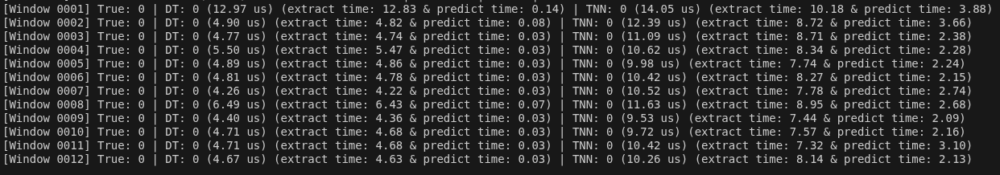

- **Test Case 2:** The first part is normal data, and the latter part is normal data interleaved with injected DoS attack frames, extracted from a segment of the `DoS_dataset`.

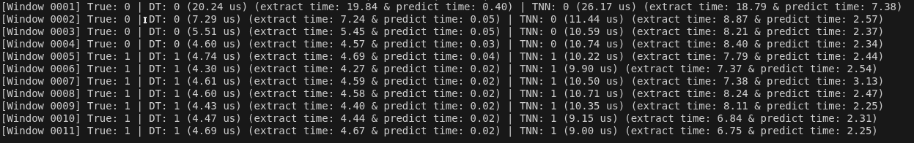

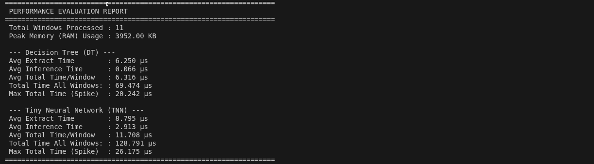

## RPM Attack:
- **Test Case 1:** Pure normal data extracted from the normal segment of the `Fuzzy_dataset`.

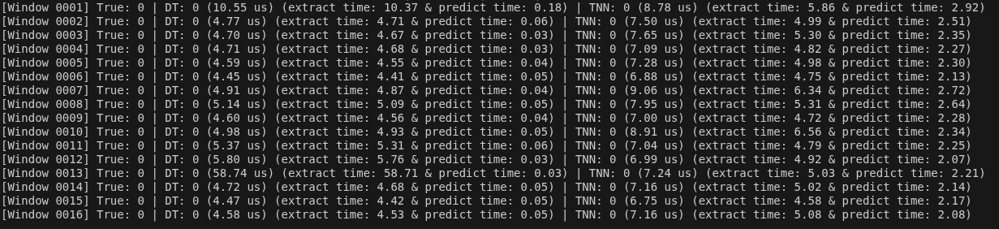

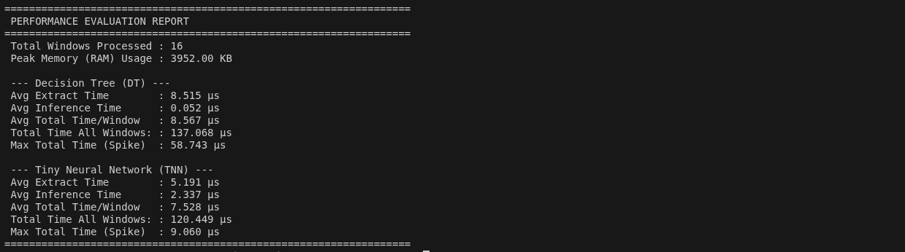

- **Test Case 2:** The first part is normal data, and the latter part is normal data interleaved with injected RPM attack frames, extracted from a segment of the `RPM_dataset`.

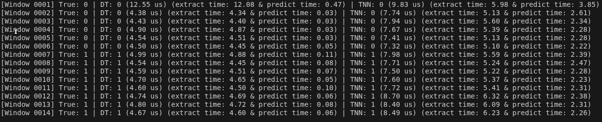

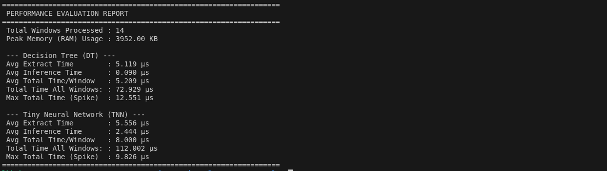

## Model Accuracy Measurement
## DoS Attack:
### DT

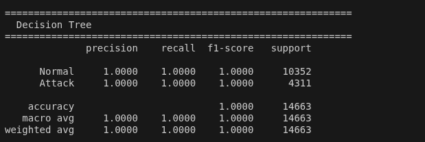

### TNN

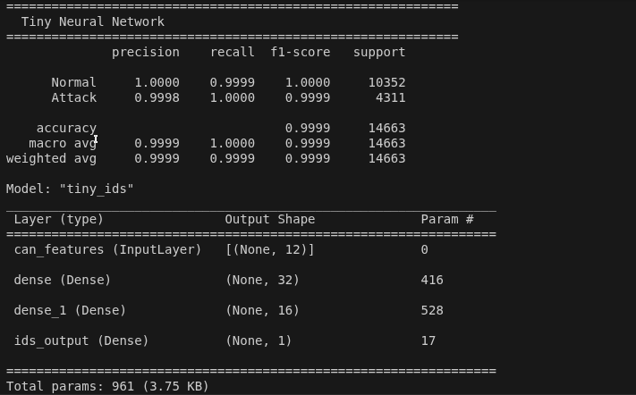

## RPM Attack:
### DT

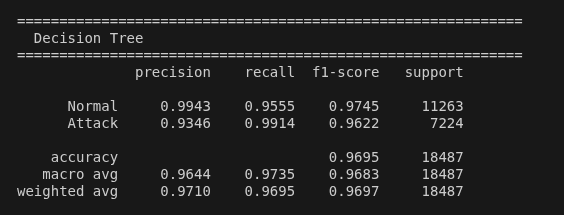

### TNN

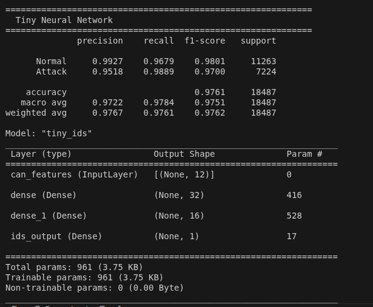

## gear Attack:
### DT

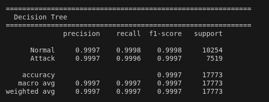

# On Raspberry Pi Device:
## DoS Attack:
### Decision Tree
- **Test Case 1:** Use the simulation app and select DoS attack. The generated synthetic data totals **1,227 CAN frames**, consisting of **1,000 attack frames** (Attack ID is `0x000`) and **227 synthetic normal frames**. The interval between attack frames is **0.5ms**.
  - -> **Result:** All **25 windows** successfully detected the **Attack (1).**

- **Test Case 2:** Use the simulation app and select DoS attack. The attack data is injected into a file containing normal CAN frames extracted from a normal segment of the `Fuzzy_attack` dataset (Attack ID is `0x000`). The total number of CAN frames is **1,191**, with **600 injected attack frames** and **591 normal CAN frames** read from the file. The interval between attack frames is **0.5ms**.
  - -> **Result:** All **23 windows** successfully detected the **Attack (1)**.
- **Test Case 3:** Use the simulation app and select RPM attack. The data used is a file containing **600 normal CAN frames** extracted from a normal segment of the `Fuzzy_dataset`, with an interval between normal frames of **0.5ms - 1ms**.
  - -> **Result:** All **12 windows** successfully detected **normal traffic (0)**.
- **Test Case 4:** Use the simulation app and select only the attack frames extracted from a portion of the `DoS_dataset` file. The total number of **attack frames is 198**, with an interval between frames of **0.5ms**.
  - -> **Result:** All **3 windows** successfully detected the **attack (1)**. 

### TNN
- **Test Case 1:** Use the simulation app and select DoS attack. The generated synthetic data totals **1,299 CAN frames**, consisting of **1,000 attack frames** (Attack ID is `0x000`) and **299 synthetic normal frames**. The interval between attack frames is **0.5ms**.
  - -> **Result:** All **26 windows** successfully detected the **Attack (1)**.
- **Test Case 2:** Use the simulation app and select DoS attack. The attack data is injected into a file containing normal CAN frames extracted from a normal segment of the `Fuzzy_attack` dataset (Attack ID is `0x000`). The total number of **CAN frames is 1,191**, with **600 injected attack frames** and **581 normal CAN frames** read from the file. The interval between attack frames is **0.5ms**.
  - -> **Result:** All **23 windows** successfully detected the **Attack (1)**.
- **Test Case 3:** Use the simulation app and select RPM attack. The data used is a file containing **600 normal CAN frames** extracted from a normal segment of the `Fuzzy_dataset`, with an interval between normal frames of **0.5ms - 1ms**.
  - -> **Result:** All **12 windows** successfully detected **normal traffic (0)**.
- **Test Case 4:** Use the simulation app and select only the attack frames extracted from a portion of the `DoS_dataset` file. The total number of **attack frames is 198**, with an interval between frames of **0.5ms**.
  - -> **Result:** All **3 windows** successfully detected the **Attack (1)**.

## RPM Attack:
### Decision Tree
- **Test Case 1:** Use the simulation app and select RPM attack. The generated synthetic data totals **1,515 CAN frames**, consisting of **1,000 attack frames** (`ID=0x0316, DLC=8, payload=45 29 24 FF 29 24 00 FF`) and **515 synthetic normal frames**. The interval between attack frames is **1ms**.
  - -> **Result:** All **30 windows** successfully detected the **Attack (1)**.
- **Test Case 2:** Use the simulation app and select RPM attack. The attack data is injected into a file containing normal CAN frames extracted from a normal segment of the `Fuzzy_attack` dataset (`Attack ID=0x0316, DLC=8, payload=45 29 24 FF 29 24 00 FF`). The total number of CAN frames is **1,403**, with **600 injected attack frames** and **803 normal CAN frames** read from the file. The interval between attack frames is **1ms**.
  - -> **Result:** All **28 windows** successfully detected the **Attack (1)**.
- **Test Case 3:** Use the simulation app and select RPM attack. The data used is a file containing **803 normal CAN frames** extracted from a normal segment of the `Fuzzy_dataset`, with an interval between normal frames of **0.5ms - 1ms**.
  - -> **Result:** All **16 windows** successfully detected **normal traffic (0)**.
- **Test Case 4:** Use the simulation app and select only the attack frames extracted from a portion of the `RPM_dataset` file. The total number of **attack frames is 198**, with an interval between frames of **1ms**.
  - -> **Result:** All **3 windows** successfully detected the **Attack (1)**.

### TNN

- **Test Case 1:** Use the simulation app and select RPM attack. The generated synthetic data totals **1,299 CAN frames**, consisting of **1,000 attack frames** (`ID=0x0316, DLC=8, payload=45 29 24 FF 29 24 00 FF`) and **515 synthetic normal frames**. The interval between attack frames is **1ms**.
  - -> **Result:** All **30 windows** successfully detected the **Attack (1)**.
- **Test Case 2:** Use the simulation app and select RPM attack. The attack data is injected into a file containing normal CAN frames extracted from a normal segment of the `Fuzzy_attack` dataset (Attack ID is `0x000`). The total number of CAN frames is **1,403**, with **600 injected attack frames** and **803 normal CAN frames** read from the file. The interval between attack frames is **1ms**.
  - -> **Result:** All **28 windows** successfully detected the **Attack (1)**.
- **Test Case 3:** Use the simulation app and select RPM attack. The data used is a file containing **803 normal CAN frames** extracted from a normal segment of the `Fuzzy_dataset`, with an interval between normal frames of **0.5ms - 1ms**.
  - -> **Result:** All **16 windows** successfully detected **normal traffic (0)**.
- **Test Case 4:** Use the simulation app and select only the attack frames extracted from a portion of the `RPM_dataset` file. The total number of **attack frames is 136**, with an interval between frames of **1ms**.
  - -> **Result:** All **2 windows** successfully detected the **Attack (1)**.

## Gear Attack:
### Decision Tree
- **Test Case 1:** Use the simulation app and select gear attack. The generated synthetic data totals **1,526 CAN frames**, consisting of **1,000 attack frames** (`ID=0x043F, DLC=8, payload=01 45 60 FF 6B 00 00 00`) and **526 synthetic normal frames**. The interval between attack frames is **1ms**.
  - -> **Result:** All **30 windows** successfully detected the **Attack (1)**.
- **Test Case 2:** Use the simulation app and select gear attack. The attack data is injected into a file containing normal CAN frames extracted from a normal segment of the `Fuzzy_attack` dataset (`Attack ID=0x043F, DLC=8, payload=01 45 60 FF 6B 00 00 00`). The total number of CAN frames is **1,403**, with **600 injected attack frames** and **803 normal CAN frames** read from the file. The interval between attack frames is **1ms**.
  - -> **Result:** All **28 windows** successfully detected the **Attack (1)**.
- **Test Case 3:** Use the simulation app and select gear attack. The data used is a file containing **803 normal CAN frames** extracted from a normal segment of the `Fuzzy_dataset`, with an interval between normal frames of **0.5ms - 1ms**.
  - -> **Result:** All **16 windows** successfully detected **normal traffic (0)**.
- **Test Case 4:** Use the simulation app and select only the attack frames extracted from a portion of the `gear_dataset` file. The total number of **attack frames is 155**, with an interval between frames of **1ms**.
  - -> **Result:** All **3 windows** successfully detected the **Attack (1)**.

# On CHUB Device:

**Note:** The CHUB device does not use native SocketCAN. Instead, CAN frames are sent from the simulation app on the Raspberry Pi and received on the CHUB using `tdr_candump`. Because this is a live CAN network with multiple nodes, there is constant background traffic, predominantly CAN frames with `id=0x40000000 dlc=8 data=00 00 00 00 00 00 00 00`. The models continuously classify these repetitive background frames as an attack (1). The testing process involves injecting our test datasets into this noisy CAN bus and evaluating how the models react to the injected windows.

## DoS Attack:
### Decision Tree
- **Test Case 1:** Since the CHUB CAN bus constantly receives background frames (`id=0x40000000`) which the model flags as an attack, we injected **803 normal CAN frames** (extracted from a normal segment of the `Fuzzy_dataset`) to verify if the model correctly transitions to detecting normal traffic.
  - -> **Result:** Windows containing only background noise were detected as **Attack (1)**. As soon as the windows filled with injected normal CAN frames, the model successfully detected them as **Normal (0)**.
  - *Note:* In the first transitional window (12 background frames mixed with normal frames), the model still detected it as **Normal (0)**. In the final transitional window (14 normal frames followed by the background frames resuming), the model detected it as **Attack (1)**.
- **Test Case 2:** Inject mixed DoS attack frames into a normal file (extracted from `Fuzzy_dataset` on the Raspberry Pi) onto the CHUB CAN bus.
  - -> **Result:** All windows were successfully detected as **Attack (1)**.

### TNN
- **Test Case 1:** Similar to DT, we injected **803 normal CAN frames** (extracted from a normal segment of the `Fuzzy_dataset`) to verify normal traffic detection amidst background noise.
  - -> **Result:** Windows containing only background noise were detected as **Attack (1)**. As soon as the windows filled with injected normal CAN frames, the model successfully detected them as **Normal (0)**.
  - *Note:* In the first transitional window (10 background frames mixed with normal frames), the TNN model detected it as **Attack (1)** (differing from the DT model). In the final transitional window (12 normal frames followed by background frames resuming), the model detected it as **Attack (1)**.
- **Test Case 2:** Inject mixed DoS attack frames into a normal file (extracted from `Fuzzy_dataset` on the Raspberry Pi) onto the CHUB CAN bus.
  - -> **Result:** All windows were successfully detected as **Attack (1)**, *except for the 2nd window*. The 2nd window was the first to contain interleaved attack frames mixed with 6 background frames. The expected result was **Attack (1)**, but the model returned **Normal (0)**.
  - *Evaluation:* Accuracy **25/26**.

## RPM Attack:
### Decision Tree
- **Test Case 1:** Inject mixed RPM attack frames into a normal file (extracted from `Fuzzy_dataset` on the Raspberry Pi) onto the CHUB CAN bus.
  - -> **Result:** All windows were successfully detected as **Attack (1)**.
- **Test Case 2:** Inject **803 normal CAN frames** (extracted from a normal segment of the `Fuzzy_dataset`) to verify normal traffic detection amidst background noise.
  - -> **Result:** Windows containing only background noise were detected as **Attack (1)**. As soon as the windows filled with injected normal CAN frames, the model successfully detected them as **Normal (0)**.
  - *Note:* In the first transitional window (6 background frames mixed with normal frames), the model detected it as **Normal (0)**. In the final transitional window (9 normal frames followed by background frames resuming), the model detected it as **Attack (1)**.

### TNN
- **Test Case 1:** Inject mixed RPM attack frames into a normal file (extracted from `Fuzzy_dataset` on the Raspberry Pi) onto the CHUB CAN bus.
  - -> **Result:** All windows were successfully detected as **Attack (1)**.
- **Test Case 2:** Inject **803 normal CAN frames** (extracted from a normal segment of the `Fuzzy_dataset`) to verify normal traffic detection amidst background noise.
  - -> **Result:** Windows containing only background noise were detected as **Attack (1)**. As soon as the windows filled with injected normal CAN frames, the model successfully detected them as **Normal (0)**.