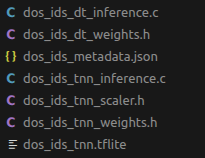
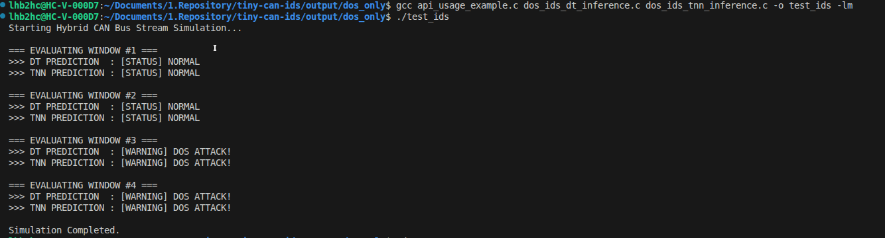

# DoS-IDS
## Concept:
Train model to detect DoS attack. Develop an **Intrusion Detection System (IDS)** to prevent **Denial of Service (DoS)** attacks on a CAN Bus network. The system requires high accuracy, real-time processing capabilities, and must leverage the powerful capabilities of embedded microcontrollers (MCUs/TCUs) used in automotive applications.. The goal is to create a **weights file (.h)** and an **API file (.c)** that provide the processing logic.
### 1. What is DoS attack?
A DoS (Denial of Service) attack is a type of attack that involves spamming messages with small IDs (high priority) to log the bus network, leading to crashes.

**Technical Nature (Priority Takeover Mechanism)**
The essence of DoS on a CAN network lies in its **Arbitration** mechanism. The CAN network uses the rule: **"Lower ID wins."**

- **ID 0x000:** In a CAN network, ID 0x000 is the absolute highest priority identifier.

- **Overriding Mechanism:** When two ECUs send messages simultaneously, the CAN network compares each bit of the ID. Bit 0 (Dominant) overrides bit 1 (Recessive). Because ID 0x000 consists entirely of 0 bits, it will always win any bandwidth dispute.

- **Flooding Tactic:** The attacker uses a hacking device plugged into the OBD-II port and programmed to continuously pump thousands of ID 0x000 messages per second into the bus network.

- **Consequence:** Because the bus network is always busy processing ID 0x000 (as it has the highest priority and appears continuously), other valid messages (such as ID 0x130 of the drive system) will be pushed into an endless queue and never sent.
### 2. Which models i will use?
- **Decision Tree:** DT operates based on thresholds, making it extremely stable against physical fluctuations in the data and requiring no normalization. During implementation, the DT is converted into pure `if-else` statements. This is the most basic structure of a CPU, allowing conclusions to be reached in just a few millionths of a second (μs) without the need for a floating-point unit (FPU).
- **Tiny Neural Network:** Unlike DTs, which only consider thresholding, TNNs are capable of learning nonlinear relationships and combining properties between characteristics such as time-distribution offsets and bit structures in data.

## Implement a step-by-step pipeline.
### 1. Data Preprocessing
Data processing continues to follow the standard procedures already implemented in thepipeline.

**a. Data Cleaning:** The data may contain lines with DLC (Diagram Data Code) of 8, but also lines that may be missing data or have incorrect formatting.
* **Task:** Remove blank lines, lines without Timestamp or ID.

* **Execution:** Ensure each line contains all the necessary components: Timestamp, ID, DLC, and data bytes.

**b. Format Conversion:** Model cannot directly process Hexadecimal (base 16) codes --> convert all to integers.
* **CAN ID:** Convert from Hex (e.g., 02c0, 329) to integers (704, 809).
* **Payload (Data0 -Data7):** Convert each byte from Hex (e.g., dc, b8, ff) to integers from 0 to 255.
* **Timestamp:** Maintain the floating-point format to calculate the time interval between messages.

**c. Data Padding:** Sometimes a CAN message has a DLC smaller than 8.
* **Task:** Ensure the input is always a fixed array of 8 bytes of data.
* **Implementation:** If DLC < 8, the missing data columns will be filled with 0. This helps the data matrix maintain a consistent size.

**d. Label Encoding:** Machine learning requires numerical labels to calculate the loss function.
* **Rule:** 
    * Label R (Normal/Regular) → Convert to 0. 
    * Label T (Attack/Target) → Convert to 1.
* **Result:** A Binary label column (0 and 1).

**e. Data Integration:** Combine all processed columns into a complete data frame.

### 2. Feature Engineering

**a. Sliding Window Logic Technique**: Instead of loading each line into the model, group the data.
* **Window Size:** Usually chosen as 50 or 100 messages.
* **Mechanism:** Every 50 messages that pass through, we capture them once to create a feature vector.
* **Purpose:** To calculate statistical parameters (such as frequency, standard deviation) that a single message cannot represent.

**b. Feature Extraction**: 
**The 8 Core Characteristics (For Decision Trees)**
Focus on behavioral cues to detect physical thresholds of DoS attacks:

1. **Mean Δt (Average Time Distance):** Identifies the reduction in time intervals when messages are being pumped in rapid succession. In DoS attacks, this number will drop sharply to near zero.

2. **Std Δt (Standard Time Deviation):** DoS attacks are often scripted, so the timing is extremely consistent, resulting in a very small standard deviation.

3. **Message Rate:** The most direct indicator; a sudden increase in the number of messages is a leading sign of a denial-of-service (DoS) attack. (e.g., from 2000 to 10,000 messages/second).

4. **Dominant ID Frequency:** Determines the dominance of ID 0x000 (bus priority).

5. **Shannon ID Entropy:** Measures network diversity; DoS makes the network monotonous, causing entropy will drop to extremely low levels.

6. **Min Delta (Minimum Time Interval):** If two DoS messages appear very close together (due to the spamming speed of the attack tool), Min Δt will immediately drop to near zero.

7. **Longest Consecutive ID Sequence (Maximum Consecutive IDs):** Detects continuously duplicated ID sequences – a characteristic never present under normal vehicle operation conditions. During a DoS attack, the attacker will spam the same ID repeatedly (e.g., 000, 000, 000, 000...).

8. **High-Priority ID Ratio:** To successfully launch a DoS attack on a CAN network, hackers must use very small IDs (usually < 0x100) to overcome the arbitration mechanism and block other ECUs.

**Enhanced Feature Set (Adds 4 features to TNN)**
TNN has acquired four additional characteristics to delve deeper into "patterns" and "content":

9. **Mean Hamming Weight:** The average number of "1" bits in 8 bytes of data. TNN uses this to identify meaningless data patterns (like all zeros or all ones) commonly found in junk DoS attacks.

10. **Data Change Rate:** The rate of data change between consecutive messages (DoS attacks usually send static data).

11. **ID Gaps:** Count the number of "missing" ECUs in the data window. When a DoS attack takes control of the bus, other ECUs will be unable to send messages, creating ID gaps.

12. **Skewness Δt:** Measure the deviation of the time distribution. TNN uses this metric to understand the tempo of the attack, differentiating between natural network overload and targeted attacks.

### 3. Model Training/Optimization:

**a. Train/Test Split**: 
Before training, the data is split into two independent parts to ensure the model's generalizability.
* **Training Set (80%):** Used to train the model parameters.
* **Test Set (20%):** Used to evaluate performance on data the model has never processed before.
* **Stratify Technique:** Ensures that the proportion of Normal and Attack labels in both datasets is equal.

**b. Standard Scaling**
Features such as Message Rate and ID Entropy have large scaling differences. This is applied to TNN to bring features with large amplitude differences to the same distribution (Mean = 0, Std = 1).

* **Benefits:** Helps the convergence process of Neural Networks faster with large values dominating.

**c. Trainning Models**
**Decision Tree (DT) – Low-Latency Priority Layer**
The Decision Tree serves as the primary, rule-based filtering layer, optimized for extreme low-latency execution on edge devices.

- **Operating Principle:** The algorithm recursively partitions incoming network traffic based on learned feature thresholds. For instance, a direct logical split might be: If (`Message_Rate` > 8000) AND (`Dominant_ID_Freq` > 0.6) ➔ Classify as DoS Attack (**Label = 1**).

- **TinyML Optimization:** To ensure compatibility with resource-constrained MCUs, the model is aggressively pruned by setting `max_depth` = 5. This hyperparameter tuning not only prevents overfitting but also drastically minimizes the number of nested `if-else` branches required when exporting the model to bare-metal C code, thereby saving both execution cycles and Flash memory.

**Tiny Neural Network (TNN) – High-Accuracy Analysis Layer**
To complement the DT, a micro-structured neural network (e.g., a 32-16-1 dense architecture) is deployed to detect sophisticated anomalies.

- **Network Structure:**

    - **Input Layer:** Dynamically receives the extracted and scaled feature vector.

    - **Hidden Layers:** Utilizes the ReLU (Rectified Linear Unit) activation function to ensure computational efficiency and prevent vanishing gradients during training.

    - **Output Layer:** Consists of a single neuron applying a Sigmoid activation function to output a clear probability threshold for Binary Classification (Normal vs. Attack).

- **Primary Objective:** The core task of the TNN is to capture complex, non-linear relationships and subtle behavioral shifts in the CAN traffic (such as temporal skewness and ID gaps) that traditional linear models or shallow trees might fail to detect.

**d. Performance Evaluation (Model Evaluation)**
After training, performance is measured based on the following metrics:
* **Accuracy:** The percentage of correct predictions out of the total number of samples.
* **F1-Score:** The average value between Precision and Recall. For DoS attacks, Recall is extremely important because the system cannot afford to miss any attack windows.

### 4. Model Quantization (INT8)
Model quantization is a critical optimization technique that maps neural network parameters (weights and biases) from a 32-bit floating-point representation (`float32`, consuming 4 bytes per parameter) down to a lower-precision 8-bit integer format (`int8_t`).

**Key Benefits for Embedded Deployment:**

- **Flash Memory Footprint:** Achieves a ~75% reduction in non-volatile storage requirements. This allows the heavy matrices within the generated C header (`.h`) files to fit seamlessly into the strict ROM constraints of automotive MCUs/TCUs.

- **Runtime RAM Efficiency:** Substantially decreases the SRAM required for intermediate activation buffers during the model's forward pass across hidden layers.

- **Inference Latency & Throughput:** By shifting from floating-point arithmetic to integer-based math, the execution pipeline fully leverages specialized DSP. This eliminates the massive overhead of software-emulated floating-point operations, driving inference latency down to the microsecond scale.

### 5. Export & Capsule API Design
To bridge the gap between machine learning frameworks and bare-metal environments, an automated C-code generation pipeline was developed.

* **Artifact Generation:** The pipeline automatically translates trained models into standalone, dependency-free C headers and source files (e.g., `dos_ids_dt_weights.h,` `dos_ids_tnn_inference.c`, and a descriptive `metadata.json`).

*  **Capsule API Architecture:** The system encapsulates complex internal logic (feature extraction, standardization, and matrix multiplication) behind a single, high-level public interface: 

* **Automotive Compliance:** The generated code strictly adheres to embedded safety standards by avoiding dynamic memory allocation (malloc-free) and utilizing statically allocated arrays, preventing memory fragmentation and stack overflow risks.

## Experimental Results & Performance Validation
The hybrid architecture was evaluated based on computational footprint and detection accuracy. The table below summarizes the validation results for both the Decision Tree and the Tiny Neural Network (INT8):

**Analysis of Results:**

- **The Decision Tree (Pruned)** requires a mere **~296 Bytes** of Flash memory while achieving an **84.72% F1-Score**. This makes it an exceptionally lightweight primary filter capable of instant anomaly detection.

- **The Tiny Neural Network (INT8)** acts as the deep-analysis layer, achieving an outstanding **96.76% F1-Score**. Through quantization, its memory footprint is compressed to just **~5.2 KB**, easily fitting into the strict SRAM/ROM constraints of standard automotive MCUs while preserving high fidelity against sophisticated DoS patterns.

## Simulation & System Integration Testing
To validate the models under realistic conditions, a dynamic CAN Bus stream simulator was constructed to mimic vehicle network behavior.
* **Test Case Scenarios:** The simulator injects a continuous data stream transitioning through three distinct phases: Normal State $\rightarrow$ Mixed State (initial anomaly injection) $\rightarrow$ Pure DoS Attack (network flooding).

* **Physical Parameter Synchronization:** A critical aspect of the integration test was resolving Data Distribution Shift. By calibrating the simulated message interval (`dt_us`) to 0.5ms (equivalent to a real-world CAN bus frequency of ~2000 msg/s), false positives triggered by temporal outliers were entirely eliminated.

* **Real-time Response:** Console simulation confirms that both the DT and TNN operate synchronously, successfully maintaining a `[STATUS] NORMAL` output during benign traffic and instantly triggering a `[WARNING] DOS ATTACK!` upon flood detection.

## MLOps & CI/CD Pipeline Automation
A robust, end-to-end Machine Learning Operations (MLOps) pipeline was implemented via GitHub Actions to ensure seamless continuous integration and deployment (CI/CD).

* **Automated Data Provisioning:** The pipeline automatically fetches large-scale raw CAN datasets (181MB) from cloud repositories via direct links.

* **Smart Auto-Routing:** The pipeline features a dynamic routing mechanism that automatically detects the dataset type. If a DoS dataset is identified, it bypasses the heavy 46-feature standard extraction and routes data through the optimized 8-feature (DT) and 12-feature (TNN) extraction paths.

* **Continuous Delivery:** Upon algorithm updates, the pipeline automatically triggers model retraining, generates the updated C-source code artifacts (`.c/.h`), performs compilation syntax checks, and outputs deployment-ready binaries.
