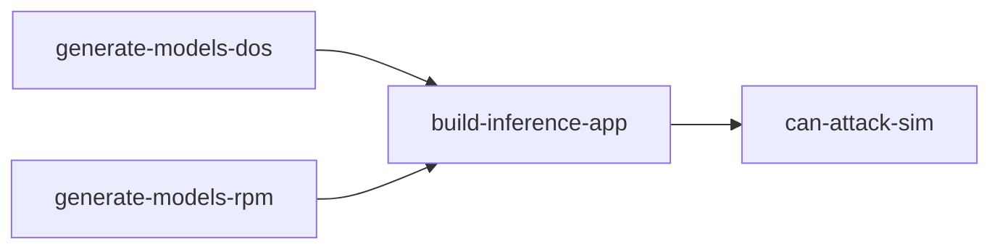

# CAN Bus Attack Simulator

Interactive CLI tool for sending CAN bus attack traffic to a Linux SocketCAN interface (including `vcan`).  
Based on patterns from the [Car Hacking Dataset (OTIDS/KAIST)](https://ocslab.hksecurity.net/Datasets/car-hacking-dataset).

---

## Requirements

- Linux with SocketCAN support (or python-can virtual bus)
- `python-can` — install with:
  ```bash
  pip install python-can
  ```
- For real hardware: a CAN interface (e.g. `vcan0`, `can0`)

### Creating a virtual CAN interface (no hardware needed)

```bash
sudo modprobe vcan
sudo ip link add dev vcan0 type vcan
sudo ip link set up vcan0
```

---

## Running the Simulator

```bash
python -m tests.simulation.can_attack_sim
# or
python tests/simulation/can_attack_sim.py
```

---

## Navigating the App

### 1. Interface Selection

On startup the app scans `/sys/class/net` for available CAN interfaces.

- If interfaces are found, you are shown a numbered list — enter the number or type the interface name directly.
- If **no interfaces are found**, the app automatically falls back to the **python-can virtual bus** (in-process loopback, no kernel module needed). Sent frames are printed to the terminal in `candump` format.

### 2. Main Menu

```
Attack Types:
  [1] DoS Flood
  [2] Fuzzy (Random)
  [3] Gear Spoofing
  [4] RPM Spoofing
  [5] Manual / CSV Replay
  [6] Scenario Testing (JSON)
  [q] Quit
```

Enter the number of the attack type you want to run, or `q` to exit.

| Option | Attack | Description |
|--------|--------|-------------|
| `1` | DoS Flood | Floods `ID=0x0000` with all-zero payloads at high rate |
| `2` | Fuzzy | Random IDs (`0x000–0x7FF`) with random payloads |
| `3` | Gear Spoofing | Injects `ID=0x043F` with a crafted gear payload |
| `4` | RPM Spoofing | Injects `ID=0x0316` with a crafted RPM payload |
| `5` | Manual / CSV | Hand-enter frames or replay from a CSV file |
| `6` | Scenario Testing | Load a JSON config to run multi-attack scenarios |
| `q` | Quit | Closes the bus and exits |

### 3. Normal Traffic Background Thread

For options **1–5**, after selecting an attack the app asks:

```
Path to normal CAN CSV (leave blank to use synthetic normal traffic):
```

- **Leave blank** — synthetic normal traffic is generated automatically (IDs `0x100–0x500`, 2 ms interval).
- **Enter a path** — frames are replayed from that CSV file alongside the attack.

Normal traffic runs in a background thread and is stopped automatically when the attack finishes.

### 4. Session Logs

Each run (options 1–5) creates a timestamped `.log` file in the **current working directory**:

```
20260624_153000_123456.log
```

The log records frames sent, timestamps, duration per attack, and a session summary.

---

## Option 6 — Scenario Testing (JSON Config)

Scenario mode lets you script a full multi-attack test session from a single JSON file.

### Running a Scenario

Select `[6]` from the main menu and enter the path to your JSON config:

```
Path to scenario JSON file: tests/simulation/test_scenario.json
```

### JSON Config Reference

```json
{
  "attack_setting": {
    "async": false,
    "attack_items": [...]
  },
  "normal_setting": {
    "ids": ["0x100", "0x200"],
    "frames": 0,
    "interval": 0.002
  }
}
```

#### `attack_setting`

| Field | Type | Description |
|-------|------|-------------|
| `async` | `bool` | `true` — all attacks run in parallel; `false` — run sequentially |
| `attack_items` | `list` | Ordered list of attack items to execute |

#### `attack_items` — each item

| Field | Type | Required | Description |
|-------|------|----------|-------------|
| `id` | `int` | Yes | Unique identifier for this item (for logging reference) |
| `attack_type` | `string` | Yes | One of: `"Dos"`, `"Fuzzy"`, `"Gear"`, `"RPM"`, `"Manual"` |
| `frames` | `int` or `list` | Yes | Frame count to send (integer), or inline frame list (Manual only — see below) |
| `frequencies` | `int` | Yes | How many times to repeat this attack |
| `repeat_interval` | `number` | Yes | Seconds to wait **between** consecutive frequency runs (not the per-frame interval) |

> **Note on `frames = 0`**: For non-Manual attacks, `0` means the attack's built-in default count is used. For Manual with `path`, `0` means all frames from the file are sent.

#### `attack_type` values

| Value | Behaviour |
|-------|-----------|
| `"Dos"` | Floods `ID=0x0000`, all-zero payload |
| `"Fuzzy"` | Random IDs and payloads |
| `"Gear"` | Injects `ID=0x043F` gear spoof payload |
| `"RPM"` | Injects `ID=0x0316` RPM spoof payload |
| `"Manual"` | Sends user-supplied frames — requires either `path` or an inline `frames` list |

#### `Manual` attack — two modes

**1. CSV file path** — add a `"path"` field pointing to a CAN CSV:

```json
{
  "id": 3,
  "attack_type": "Manual",
  "frames": 0,
  "path": "./tests/simulation/DoS_dataset.csv",
  "frequencies": 2,
  "repeat_interval": 3
}
```

**2. Inline frame list** — supply `frames` as a list of hex strings (`"ID B0 B1 ... B7"`):

```json
{
  "id": 4,
  "attack_type": "Manual",
  "frames": [
    "043F 01 45 00 00 00 00 00",
    "043F 01 46 00 00 00 00 00"
  ],
  "frequencies": 2,
  "repeat_interval": 3
}
```

Each string format: `<3-digit hex ID> <up to 8 space-separated hex bytes>`

#### `normal_setting`

Configures the background normal traffic thread that runs throughout the entire scenario.

| Field | Type | Required | Description |
|-------|------|----------|-------------|
| `ids` | `list` | No | CAN arbitration IDs to cycle through. Accepts integers or hex strings (`"0x100"`). Defaults to `["0x100","0x200","0x300","0x400","0x500"]` |
| `frames` | `int` | Yes | Total normal frames to send. Use `0` to run continuously until all attacks finish |
| `interval` | `float` | Yes | Seconds between normal frames (e.g. `0.002` = 2 ms) |

---

## Example Config (`test_scenario.json`)

```json
{
  "attack_setting": {
    "async": false,
    "attack_items": [
      {
        "id": 1,
        "attack_type": "Dos",
        "frames": 1000,
        "frequencies": 3,
        "repeat_interval": 2
      },
      {
        "id": 2,
        "attack_type": "Fuzzy",
        "frames": 500,
        "frequencies": 2,
        "repeat_interval": 1
      },
      {
        "id": 3,
        "attack_type": "Manual",
        "frames": 0,
        "path": "./tests/simulation/DoS_dataset.csv",
        "frequencies": 2,
        "repeat_interval": 3
      },
      {
        "id": 4,
        "attack_type": "Manual",
        "frames": [
          "043F 01 45 00 00 00 00 00",
          "043F 01 46 00 00 00 00 00"
        ],
        "frequencies": 2,
        "repeat_interval": 3
      }
    ]
  },
  "normal_setting": {
    "ids": ["0x100", "0x200", "0x300", "0x400", "0x500"],
    "frames": 0,
    "interval": 0.002
  }
}
```

This config runs **sequentially**:
1. DoS × 3 runs, 2 s pause between each
2. Fuzzy × 2 runs, 1 s pause between each
3. Manual (from CSV) × 2 runs, 3 s pause between each
4. Manual (inline frames) × 2 runs, 3 s pause between each

Normal traffic (`0x100–0x500`, 2 ms interval) runs in the background throughout.

---

## CSV File Format

The simulator expects CAN CSV files in the Car Hacking Dataset format:

```
Timestamp,ID,DLC,D1,D2,D3,D4,D5,D6,D7,D8,Flag
0.000007,02BC,8,00,00,00,00,00,00,00,00,R
0.000513,0000,8,00,00,00,00,00,00,00,00,T
```

- `Flag = R` — normal (received) frame
- `Flag = T` — attack (transmitted/injected) frame

When loading in Manual CSV mode interactively, you can choose to send attack frames only (`T`) or all frames.

---

## CI — GitHub Actions (`can-attack-sim.yml`)

The workflow at [`.github/workflows/can-attack-sim.yml`](../../.github/workflows/can-attack-sim.yml) automates the full build-and-smoke-test pipeline in GitHub Actions.

### Trigger

```yaml
on:
  workflow_call:   # called from another workflow (e.g. main CI)
  workflow_dispatch:  # manually triggered from the Actions tab
```

### Pipeline Overview



| Job | Depends on | Purpose |
|-----|-----------|---------|
| `generate-models-dos` | — | Trains and exports DoS detection models |
| `generate-models-rpm` | — | Trains and exports RPM detection models |
| `build-inference-app` | both model jobs | Compiles the native C inference binary |
| `can-attack-sim` | `build-inference-app` | Runs all simulator smoke tests on `vcan0` |

### What the Smoke Tests Do

The `can-attack-sim` job:

1. Downloads the compiled `can_test_app` binary artifact from `build-inference-app`.
2. Creates a `vcan0` virtual interface via `modprobe vcan`.
3. Installs `can-utils` (for `candump`) and `python-can`.
4. Creates a minimal `tests/simulation/normal.csv` if it does not already exist.
5. Runs each attack type via piped stdin to `can_attack_sim.py`, alongside `candump` and the inference app in the background.
6. Tears down `vcan0` (always runs, even on failure).
7. Uploads all `.log` files under `/tmp/can-logs/` as a build artifact (`can-attack-sim-logs`, retained 1 day).

### Tests Exercised

| Test Name | Attack | Normal Traffic | Frames |
|-----------|--------|---------------|--------|
| DoS (default normal) | DoS Flood | Synthetic (auto) | 100 |
| DoS (csv normal) | DoS Flood | `tests/simulation/normal.csv` | 100 |
| Fuzzy (default normal) | Fuzzy | Synthetic (auto) | 100 |
| Fuzzy (csv normal) | Fuzzy | `tests/simulation/normal.csv` | 100 |
| Gear (default normal) | Gear Spoofing | Synthetic (auto) | 100 |
| Gear (csv normal) | Gear Spoofing | `tests/simulation/normal.csv` | 100 |
| RPM (default normal) | RPM Spoofing | Synthetic (auto) | 100 |
| RPM (csv normal) | RPM Spoofing | `tests/simulation/normal.csv` | 100 |
| Manual hand input | Hand-typed frames + `repeat` | Synthetic (auto) | ~7 |
| Manual CSV replay | CSV file replay (all frames) | Synthetic (auto) | 6 |
| Scenario (test_scenario.json) | DoS + Fuzzy + Manual × 2 | Config-driven (`0x100–0x500`) | per item |

### How stdin Automation Works

The workflow feeds answers to the simulator's interactive prompts via `printf ... | python tests/simulation/can_attack_sim.py`.  
The input sequence for each single-attack test follows this pattern:

```
<interface selection>   → "1"  (select first listed interface, i.e. vcan0)
<attack menu choice>    → "1"–"4" for standard attacks, "5" for manual
<normal CSV path>       → "" (blank = synthetic) or a CSV path
<frame count>           → "100"
<quit>                  → "q"
```

> **Note**: The normal CSV path is prompted **before** the frame count because the normal traffic thread is started first in the code, then the attack function is called.

For the **Manual hand input** test:
```
1              → select interface
5              → Manual / CSV Replay
               → blank = synthetic normal traffic
1              → hand input mode
043F 01 45 60 FF 6B 00 00 00   → send one frame
repeat 5 0.001                 → repeat last frame 5 times
repeat abc                     → invalid repeat (error handling check)
0316 45 29 24 FF 29 24 00 FF   → send another frame
done           → exit manual input
q              → quit app
```

For the **Manual CSV replay** test:
```
1                              → select interface
5                              → Manual / CSV Replay
                               → blank = synthetic normal traffic
2                              → CSV file mode
/tmp/can-logs/.../test_attack.csv  → path to generated CSV
b                              → send both attack and normal frames
y                              → use original timing
q                              → quit app
```

For the **Scenario** test:
```
1                                    → select interface
6                                    → Scenario Testing
tests/simulation/test_scenario.json  → path to scenario config
q                                    → quit app (after scenario finishes)
```

### Inference App Integration

Each standard attack test also starts the `can_test_app` binary once per model (`dt`, `tnn`, `lr`) in the background:

```bash
can_test_app --attack-type <type> --model <model> --interface vcan0 --timeout 5 -v
```

This verifies that the compiled inference binary can receive and classify the simulated attack frames in real time on `vcan0`.

> **Note**: The Manual hand input and CSV replay tests currently have the `can_test_app` steps commented out — they focus on verifying the simulator's parsing and send logic only.

### Artifacts

After the workflow completes, download logs from the **Actions → Artifacts** panel:

- **`can-attack-sim-logs`** — contains `candump.log` and `can_test_app_<model>.log` for each attack scenario, stored under `/tmp/can-logs/<attack_type>/`.
